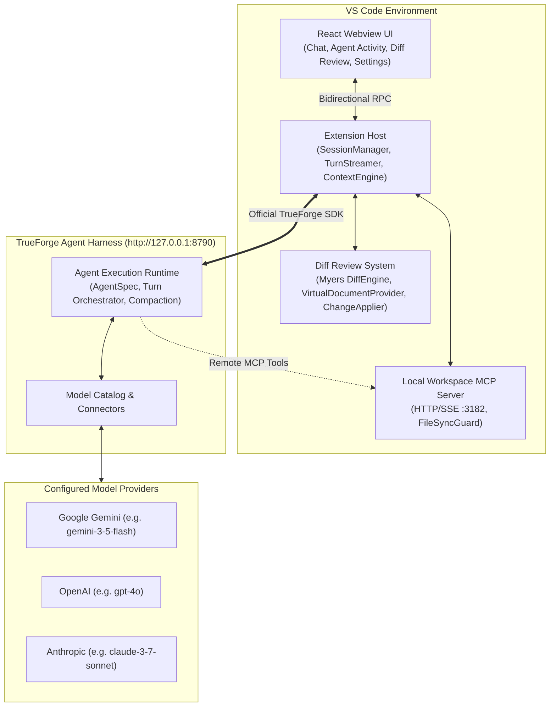

# Runtime Terrors

> **A professional VS Code-native AI coding assistant powered exclusively by the official TrueForge agent execution runtime.**

Runtime Terrors integrates the full capabilities of the [TrueForge](https://trueforge.dev) agent harness directly into VS Code. Built strictly according to the hackathon architectural rules, Runtime Terrors does **not** implement a separate LLM orchestration loop and makes **no direct calls** to commercial model provider APIs. Instead, all model selection, reasoning, turn streaming, subagents, context compaction, and tool scheduling are delegated to TrueForge via the official `@truefoundry/trueforge-sdk`.

---

## Architecture Overview



### Architectural Guarantees
1. **TrueForge Handles the Agent Loop**: Model prompting, chain-of-thought reasoning, subagent delegation, and tool scheduling are executed on TrueForge.
2. **Zero Direct LLM Provider Calls**: The extension contains no direct API calls to OpenAI, Anthropic, Google, or other model APIs.
3. **Official SDK Only**: All interactions use official `@truefoundry/trueforge-sdk` methods and typed Server-Sent Events (SSE).
4. **Non-Destructive Safety Boundary**: No workspace file is ever silently overwritten. All modifications require developer review and approval in the visual Diff Review System.
5. **Runtime Decoupling Note**: The official TrueForge repository is used as an external runtime engine and is **not** included in this submission repository.

---

## Prerequisites

Before running Runtime Terrors, ensure you have:
- **Node.js**: `v18.0.0` or higher
- **VS Code**: `1.90.0` or higher
- **TrueForge Standalone Server**:
  Start the official TrueForge server in a terminal:
  ```powershell
  npx.cmd --yes @truefoundry/trueforge@0.184.2
  ```
  The server will launch and listen at **`http://localhost:8790`** (or `http://127.0.0.1:8790`).
  Configure your model provider (e.g., Gemini `google-gemini/gemini-3-5-flash` or OpenAI `openai/gpt-4o`) with your API key in TrueForge's settings.

---

## Installation & Build

### 1. Clone & Install Dependencies
```powershell
git clone https://github.com/<your-username>/runtime-terrors.git
cd runtime-terrors
npm.cmd install
```

### 2. Build the Extension & Webview
```powershell
npm.cmd run build
```
This compiles both:
- Extension Host bundle: `dist/extension.js` (via `esbuild`)
- React Webview UI: `dist/webview/` (via `vite` with Tailwind CSS)

### 3. Verify TypeScript & Test Suite
```powershell
# Typecheck with zero errors
npm.cmd run typecheck

# Run full Vitest suite (58 tests across 14 test suites)
npm.cmd test
```

---

## Launching the Extension Development Host

1. Open the `runtime-terrors` folder in VS Code.
2. Press **`F5`** (or select **Run > Start Debugging**) to launch the **Extension Development Host**.
3. In the new VS Code window that opens, open any workspace folder (e.g., `pallets/flask`).
4. Click the **Runtime Terrors** icon in the Activity Bar on the left.
5. Observe the status bar at bottom right:
   - **`✓ TrueForge (Xms)`** indicates successful connection to your local TrueForge server.
   - If offline, click the status bar item or open the **Settings** tab in the sidebar to verify your TrueForge URL (`http://127.0.0.1:8790`).

---

## Core Product Capabilities

### 1. TrueForge Chat & Streaming Responses
- **Interactive Chat Interface**: Dark developer UI with Markdown rendering, code highlighting, copy-to-clipboard, and session management.
- **Real-Time Token Streaming**: Consumes TrueForge's Server-Sent Events (`model.message.delta`) to stream tokens word-by-word.
- **Internal Reasoning Protection**: TrueForge's chain-of-thought tokens are captured for diagnostics and prevented from cluttering developer responses.
- **Instant Cancellation**: The **"Stop Generation"** button halts generation immediately using `AbortController` and dispatches `client.sessions.cancel(sessionId)` to TrueForge.

### 2. Context Engine (`@file` & `@symbol`)
- **`@file` References**: Type `@file:path/to/file` (or `@path/to/file`) in chat to inject file contents into the context.
- **`@symbol` References**: Type `@symbol:name` to resolve functions, classes, and types via VS Code's symbol provider.
- **Active Editor Context**: Captures current file, language ID, cursor position, selection, and visible ranges.
- **Security Fencing**: Strictly excludes sensitive files (`.env`, `id_rsa`, `*.pem`, `*.key`, `credentials.json`).
- **Token Budgeting**: Automatically monitors and trims context to prevent context window overflow.

### 3. Inline Code Edit (`Ctrl+Alt+I` / `Cmd+Alt+I`)
- Highlight any code block in any open file.
- Press **`Ctrl+Alt+I`** (or right-click -> **"Runtime Terrors: Inline Code Edit"**).
- Enter your natural language instruction.
- TrueForge generates a surgical replacement and stages it directly into the **Diff Review System** with **"Accept Replacement"**, **"Preview Changes"**, or **"Discard"**.

### 4. Multi-File Autonomous Agent Mode
- Toggle from **Chat** to **Agent Mode** in the chat input.
- Enter high-level multi-step programming goals without specifying filenames.
- TrueForge plans the task and uses the workspace tools to inspect directories, search code, and propose changes across multiple files.
- Real-time step progress and status timeline (`AgentActivity.tsx`).

### 5. Diff Review System & Non-Destructive Code Modification
- **Myers Diff Engine**: Hunk-by-hunk diff calculation with line numbering and addition (`+`) / deletion (`-`) statistics.
- **Dedicated Diff Review Panel**: Inspect pending diffs across all modified files.
- **Hunk-by-Hunk Review**: Selectively Accept or Reject individual hunks or entire files.
- **Native VS Code Diff Integration**: Opens side-by-side diff editors (`vscode.diff`) using custom URI scheme `runtime-terrors-diff://`.
- **Atomic Rollback & Undo Stack**: Every accepted change is recorded in an undo stack. Revert changes anytime with **"Undo Last Change"** or command `Runtime Terrors: Undo Last Applied Change`.

### 6. Workspace MCP Server
- Embedded HTTP/SSE server running on `http://127.0.0.1:3182/sse`.
- Exposes tools to TrueForge: `read_file`, `list_directory`, `propose_file_change`, `search_workspace`, and `get_symbols`.
- Registered with TrueForge via `client.settings.mcpServers.createOrUpdate(...)`.
- Guarded by `FileSyncGuard` preventing path traversal attacks outside workspace folders.

---

## Hackathon Benchmark Guide

A complete, step-by-step 4-minute demo video script for the judges' benchmark tasks on **`pallets/flask` (v3.1.3)** is provided in:

👉 **[DEMO_GUIDE.md](file:///c:/Users/hp/Downloads/RuntimeTerrors/runtime-terrors/DEMO_GUIDE.md)**

It covers:
- **Task A (Inline Edit)**: Editing `src/flask/helpers.py` (`get_debug_flag`) to handle `'off'` and `'n'` as false and verifying with `FLASK_DEBUG=off`.
- **Task B (Agent Mode)**: Adding `flask config` CLI command with secret masking, passing `pytest tests/test_cli.py -q`, and touching 3 files.
- **Task C (Resilience)**: Simulating server failure, proving editor responsiveness, and verifying clean `git status`.

---

## TrueForge SDK Methods & Events Used

| SDK Method / Resource | Purpose |
| :--- | :--- |
| `new TrueForge({ baseUrl, token })` | Client initialization |
| `client.sessions.create({ agent: { spec } })` | Session creation with model and MCP servers |
| `client.sessions.createTurnStream(sessionId, req, opts)` | Turn execution over Server-Sent Events (SSE) |
| `client.sessions.cancel(sessionId)` | Server-side in-flight turn cancellation |
| `client.settings.mcpServers.createOrUpdate(...)` | Workspace MCP server registration |
| `client.models.list()` | Dynamic catalog model discovery |

### Handled SSE Event Types
- `model.message.delta`: Text content and `reasoningContent` deltas.
- `model.message`: Finalized message with token usage metrics.
- `tool.approval_required`: Human-in-the-loop tool checkpoints.
- `turn.done`: Terminal state handling and turn metrics.

---

## License

MIT License. Developed for the TrueForge AI Coding Assistant Hackathon.
